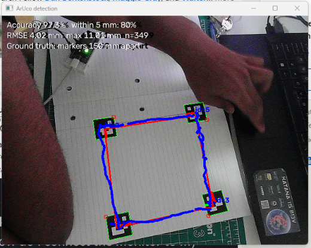

# Finger-as-a-Brush

## Accuracy test

Four ArUco markers 150 mm apart form the ground truth square (red), which is captured once at start-up and locked. A marker on the finger acts as the brush: while the force sensor (FSR) detects a touch, its position is recorded as the drawn path (blue).

Each drawn point's error is its shortest distance to the ground truth outline, converted to millimetres using the 150 mm marker spacing.

**Result for this trial (349 points):**

| Metric | Value |
| --- | --- |
| Accuracy (100 × (1 − RMSE / 150 mm)) | 97.3% |
| Points within 5 mm of the line | 80% |
| RMSE | 4.02 mm |
| Max error | 11.01 mm |

The brush point is the centre of the finger marker, not the fingertip, so any offset between the two is included in the error.
